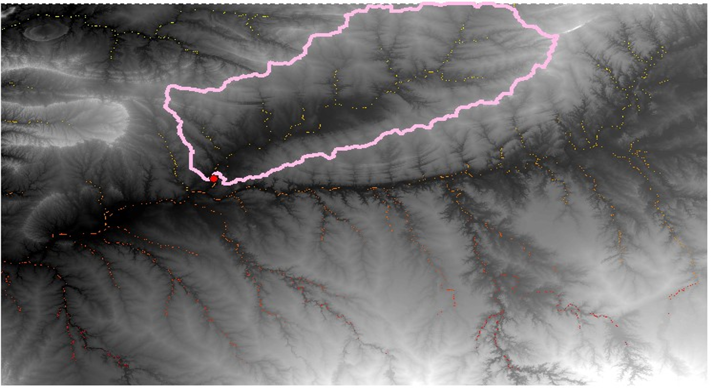

# Watershed Delineation of Soan River Basin using GIS

**Prepared by:** Aiman Afzal, Atiqa Pervez

## 📌 Project Overview
This project demonstrates a complete DEM-based hydrological modeling workflow to delineate the watershed boundary of the Soan River Basin, Pakistan. The Soan River is a major tributary of the Indus River and drains the Potohar Plateau. Understanding its hydrology is critical due to regional challenges with flooding, soil erosion, and rapid urban expansion near Islamabad and Rawalpindi.

**Objective:** To delineate the watershed boundary, generate drainage patterns, and understand surface water flow behavior using spatial analysis tools.

## 🛠️ Data & Tools
*   **Software:** ArcGIS Desktop 10.5 (Spatial Analyst & Hydrology Tools)
*   **Data Source:** USGS / SRTM Digital Elevation Model (DEM)
*   **Resolution:** 30 meters
*   **Coordinate System:** WGS 84 (reprojected to PCS for accurate area calculation)

## ⚙️ Methodology (Workflow)
The hydrological model was executed using the ArcGIS Spatial Analyst toolbox. The workflow included:
1.  **DEM Preparation:** Clipping and reprojecting the raw DEM.
2.  **Sink Filling:** Using the `Fill` tool to remove artificial depressions that block water flow.
3.  **Flow Direction & Accumulation:** Calculating the steepest descent path and identifying areas of high runoff.
4.  **Stream Definition:** Applying a Raster Calculator conditional expression (`Flow Accumulation > 20,000`) to extract the main drainage network.
5.  **Pour Point Selection:** Defining the outlet and using the `Snap Pour Point` tool to align it with the highest flow accumulation cell.
6.  **Watershed Delineation:** Tracing all upstream contributing cells using the `Watershed` tool.
7.  **Vectorization & Analysis:** Converting the watershed raster to a polygon, calculating the total area, and running `Zonal Statistics` to extract elevation data.

## 📊 Key Results
*   **Total Watershed Area:** 942.37 km² (942,372,434.64 sq meters)
*   **Elevation Range:** Minimum 269.5 m, Maximum 587.5 m
*   **Mean Elevation:** 395.43 m

> *"The analysis successfully demonstrated that watershed boundaries follow terrain rather than administrative limits, providing quantitative insights for flood risk assessment and water resource planning."*

## 🖼️ Visuals

### Final Result
**Final Watershed Delineation Map:**

### Workflow Gallery
**1. Data Preparation (DEM Processing):**

**2. Flow Analysis:**

**3. Stream and Watershed Delineation:**

## 📁 Presentation & Documentation
*Due to file size and proprietary software constraints, the raw ArcMap `.mxd` files and geodatabases are not included in this repository. The complete step-by-step workflow, intermediate tool outputs, and results are fully documented in the attached presentation.*

👉 **[Click here to view the full project presentation (PDF)](./Watershed_Delineation_Soan_River.pdf)**
